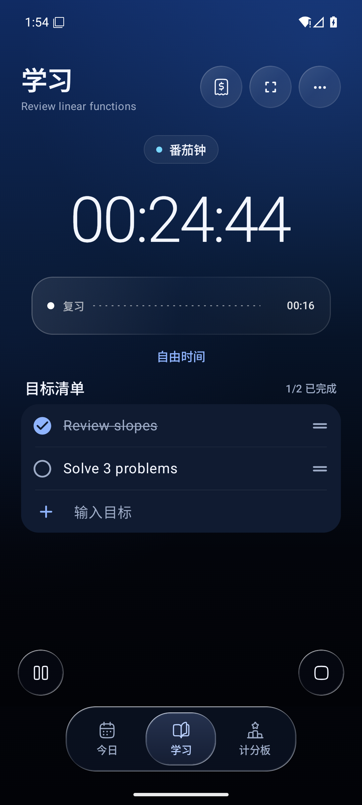
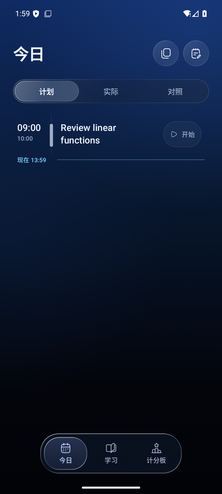
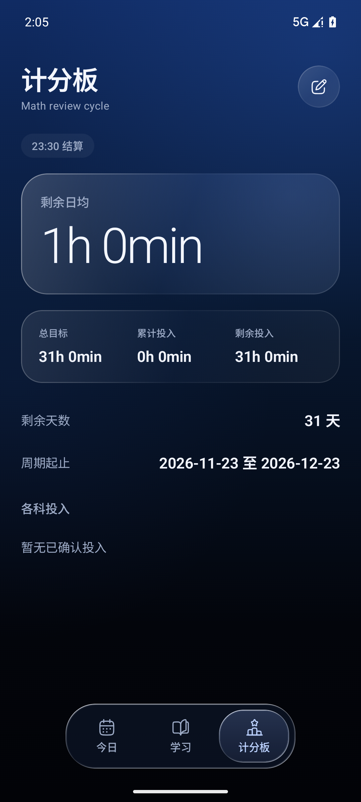

# 松果

松果是一款个人学习记录工具。用「今日」安排学习，用「学习」计时和勾选本轮任务，用「计分板」查看周期进度。

## 下载与安装

Android 版需要 Android 13 或更高版本。首个安装包准备中，发布后可在 [Releases](https://github.com/currentsync/songguo-releases/releases) 下载 `.apk` 文件。在手机上打开 APK，按系统提示完成安装。如果系统提示需要为浏览器或文件管理器开启「安装未知应用」，可在安装完成后关闭该权限。

## 使用示例

以下截图来自空白 Android 测试环境，以一次虚构的数学复习为例。

- **学习**。填写本轮目标，添加要做的事，再选择番茄钟或正计时。完成一项就勾选一项。
- **今日**。用日程模板安排学习时段，可从「计划」直接开始学习，也可切换「实际」和「对照」查看执行情况。
- **计分板**。设定周期和每日目标，查看总目标、累计投入、剩余投入，以及剩余每天需要学多久。

<table>
  <tr>
    <th>学习</th>
    <th>今日</th>
    <th>计分板</th>
  </tr>
  <tr>
    <td></td>
    <td></td>
    <td></td>
  </tr>
</table>

## 反馈

这是一个按个人使用需要更新的工具。遇到问题或有建议，欢迎在 [Issues](https://github.com/currentsync/songguo-releases/issues) 留言。报告故障时，请附应用版本、Android 版本、复现步骤、预期和实际结果。附截图或日志前，请遮盖个人学习记录、笔记和设备连接信息。
